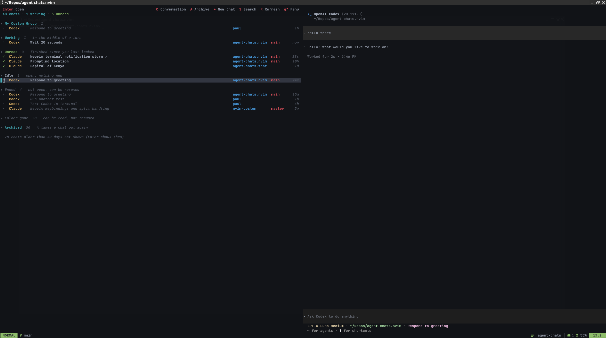

# agent-chats.nvim

One board in Neovim for every AI agent chat on your machine: Claude Code, Codex, Qwen Code and opencode.



See which chats need you, which are still working and which have finished. Go into any of them in a Neovim terminal and type, search what was said, and start new ones.

It reads what the agents already write to disk and listens to what they report through their own hooks. Nothing wraps how you start them, so chats started anywhere show up: in a Neovim terminal, in another terminal, by a script.

## Requirements

- Neovim 0.11 or newer.
- At least one of the agents. No plugin dependencies, no patched font, no build step.
- Used when present: a POSIX `sh` (the status hooks), `git`, `rg`, and the system SQLite library (opencode).

Developed and tested on Linux. It has never been run on macOS, and Windows is untested.

## Install

With Neovim's built-in plugin manager (0.12):

```lua
vim.pack.add({ 'https://github.com/paulburgess1357/agent-chats.nvim' })
require('agent-chats').setup()
```

With lazy.nvim:

```lua
{ 'paulburgess1357/agent-chats.nvim', opts = {} }
```

Then, once, run `:Chats hooks install` (see [Status hooks](#status-hooks)).

## Use

`:Chats` opens the board: the list of chats on the left, and the chat under the cursor on the right. The bar above the list names the keys: at its left what `Enter` does with the row you are on, at its right the others. `?` opens a menu with everything else, so nothing has to be remembered.

- `Enter` goes into a chat, and you type there. A chat running in this Neovim is focused, one that ended is resumed in its own folder, and one running somewhere else can only be read.
- Chats are listed by what they are doing: Needs you, Working, Unread, Idle, Ended. The menu groups them by folder, agent or worktree instead, and puts a chat in a group of your own.
- The search looks in every chat, inside the conversations too.
- A reply can be queued for when a chat finishes its turn.
- You are told when a chat needs you or finishes a turn. The menu switches that off and on.
- Chats in folders you name in `filter_out` are kept out of the way, under one folded heading.

### Keys

| Key | What it does |
| --- | --- |
| `Enter` | Go into the chat and type. On a heading: fold or unfold the group |
| `C` | Read the whole conversation (`]]` and `[[`, or `J` and `K`, move between your prompts) |
| `+` | New chat: pick the agent, and it opens |
| `S` or `/` | Search every chat |
| `R` | Refresh now (the list also refreshes by itself) |
| `A` | Archive the chat: it goes under "Archived", at the very end of the list. On an archived chat: take it out again |
| `?` or `g?` | The menu: everything else |
| `q` | Back: out of a conversation, out of a search, out of the board |
| `Esc` | End a search |
| `Tab` | Fold a group, or show a chat's subagents |

The letters are capitals, so every lowercase key stays what it is, and a default key is not bound where you have a mapping of your own on it. While you type in a chat every key goes to the agent: `<C-\><C-b>` goes back to the list.

Everything else is in the menu, and can be given a key in the `keys` option: rename, pin, label, note, a group of your own, queue a reply, a diff of the chat's folder, notifications.

### Commands

| Command | Action |
| --- | --- |
| `:Chats` | Open the board, or go to it |
| `:Chats new [agent]` | Start a new chat |
| `:Chats next` | Go into the next chat that needs you, or the next unread one |
| `:Chats search [text]` | Search every chat |
| `:Chats notify [on\|off]` | Switch notifications |

Nothing is mapped globally. For example:

```lua
vim.keymap.set('n', '<leader>ac', '<Plug>(agent-chats)')      -- the board
vim.keymap.set('n', '<leader>an', '<Plug>(agent-chats-next)') -- next chat that needs you
```

`require('agent-chats').statusline()` returns a segment such as `● 2  ◐ 3  ✓ 1` for your statusline.

## Status hooks

`:Chats hooks install` lets each agent report its own status. It shows every line it is about to change in the agent's settings and asks before writing, and `:Chats hooks uninstall` takes them out again. The board works without the hooks, but for every agent except Claude Code "Needs you" is then a guess.

## Options

`setup()` is optional, and so is every option. A few that are often wanted:

```lua
require('agent-chats').setup({
  filter_out = { 'scratch' }, -- folders whose chats are kept out of the way
  board = { layout = 'float' }, -- 'tab' (the default), 'float' or 'current'
  notify = { enabled = false }, -- no notifications
  keys = { pin = 'P' }, -- give something in the menu a key
})
```

## More

`:help agent-chats` ([`doc/agent-chats.txt`](doc/agent-chats.txt)) is the full manual: every key, command and option with its default, groups, the search, the status hooks and how status is worked out, the Lua API and events, adding another agent, and the limits. A complete small agent is in [`examples/pal.lua`](examples/pal.lua).

`:checkhealth agent-chats` reports which agents were found and where each one's status comes from.

## Development

```
make test    # every spec; needs only nvim
make lint    # stylua --check, and shellcheck on the hook script when installed
```

The tests build synthetic data in temporary folders and never read your real chats.

## License

MIT
